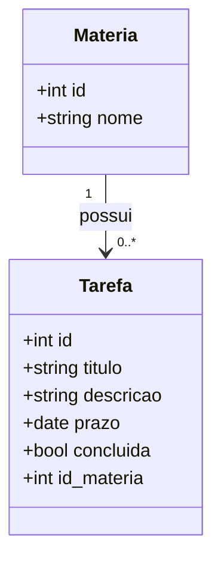
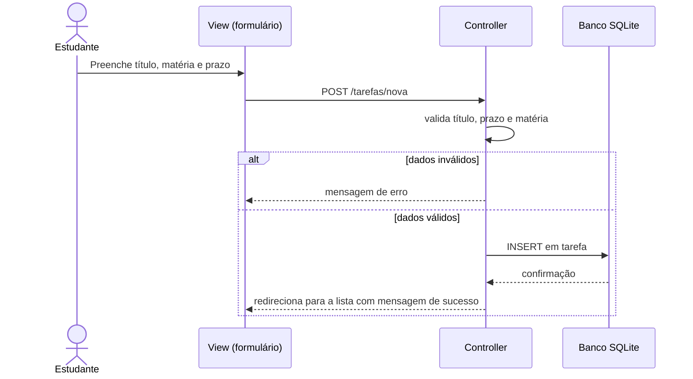

# Diagramas UML

Para ver no VS Code, instale a extensão "Markdown Preview Mermaid Support" e use Cmd+Shift+V.

## Diagrama de classes

## Diagrama de casos de uso

## Diagrama de sequência: cadastrar tarefa

## Diagrama de atividades: alternar status

