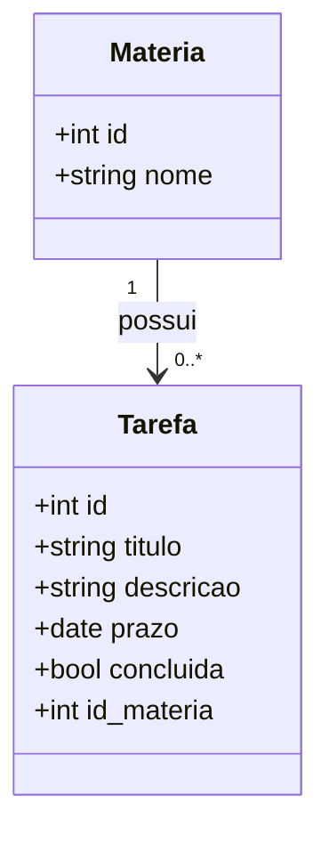
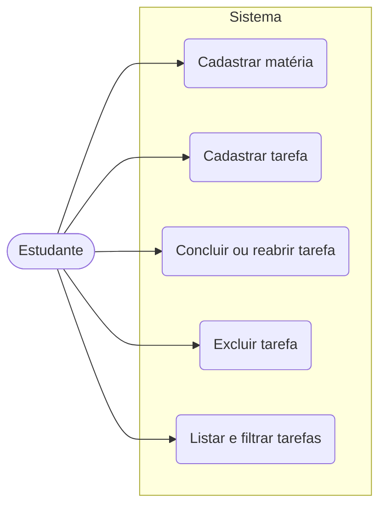
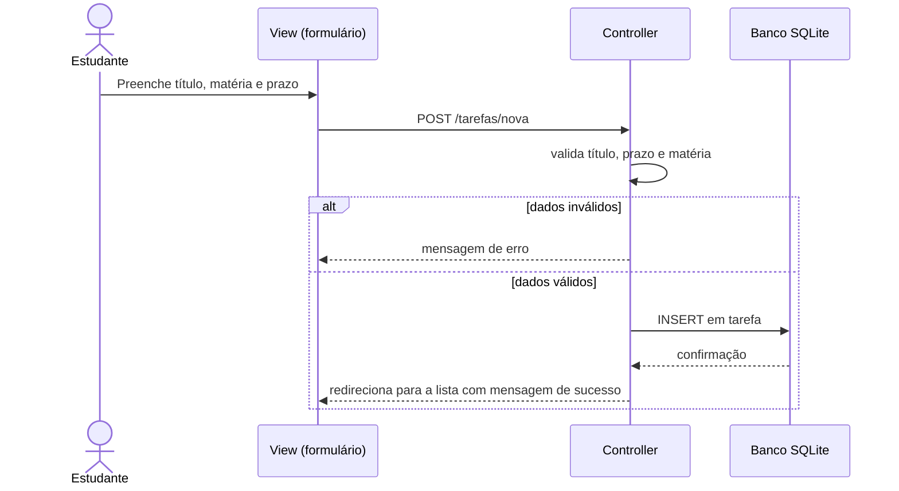
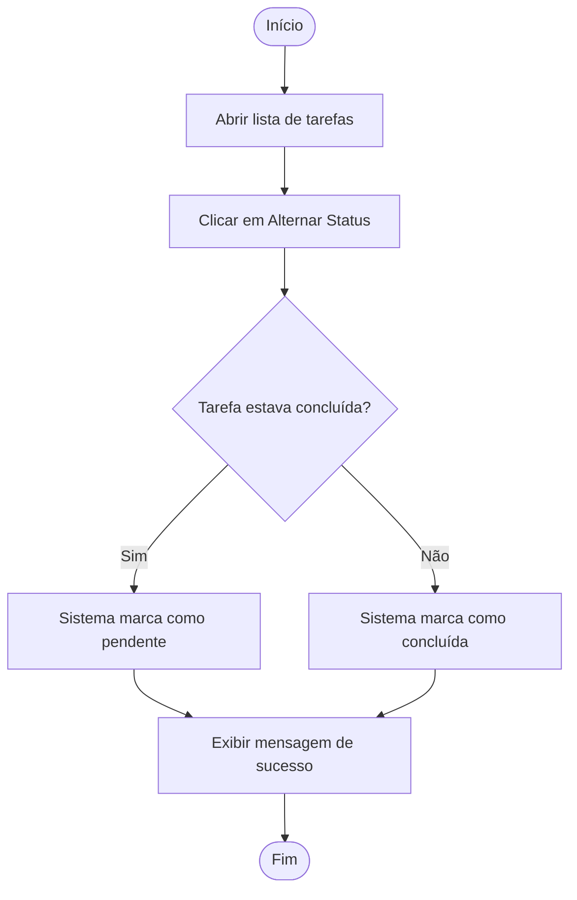

# Diagramas UML

Este documento reúne os diagramas UML do Gerenciador de Tarefas de Estudo. Eles descrevem a estrutura de dados, as funcionalidades e o fluxo das principais operações do sistema. Os diagramas foram escritos em Mermaid e são exibidos diretamente pelo GitHub.

## 1. Diagrama de classes
Representa as duas entidades do sistema, Matéria e Tarefa, com seus atributos e o relacionamento de um para muitos entre elas. Corresponde às classes de `app/models.py`.

## 2. Diagrama de casos de uso
Mostra as funcionalidades disponíveis para o estudante, que é o único ator do sistema. Cada caso de uso corresponde a uma rota de `app/controllers.py`.

Funcionalidades não implementadas nesta versão: editar tarefa e excluir matéria.

## 3. Diagrama de sequência: cadastrar tarefa
Detalha o caminho de uma requisição de cadastro, da tela até o banco de dados. Corresponde à função `nova_tarefa` do controller, que valida título, prazo e matéria antes de gravar.

## 4. Diagrama de atividades: alternar status
Mostra o fluxo de alternar uma tarefa entre pendente e concluída. Corresponde à função `concluir_tarefa` do controller.

