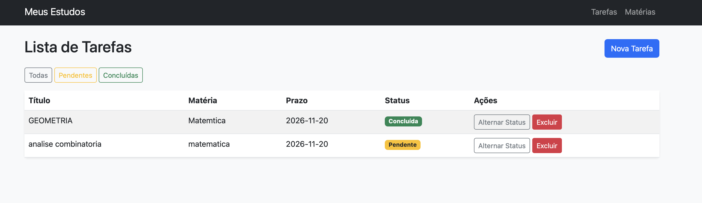
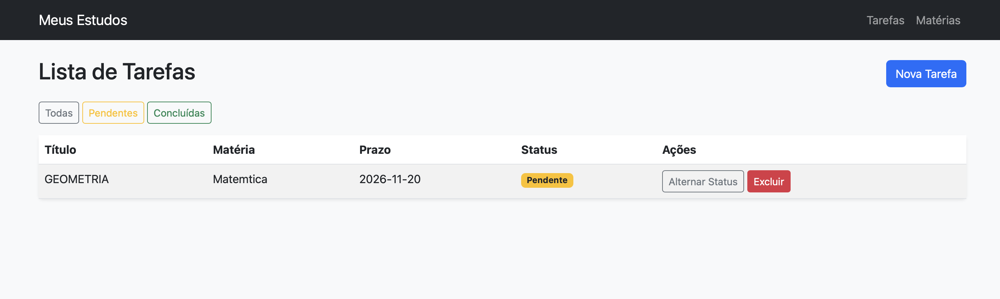
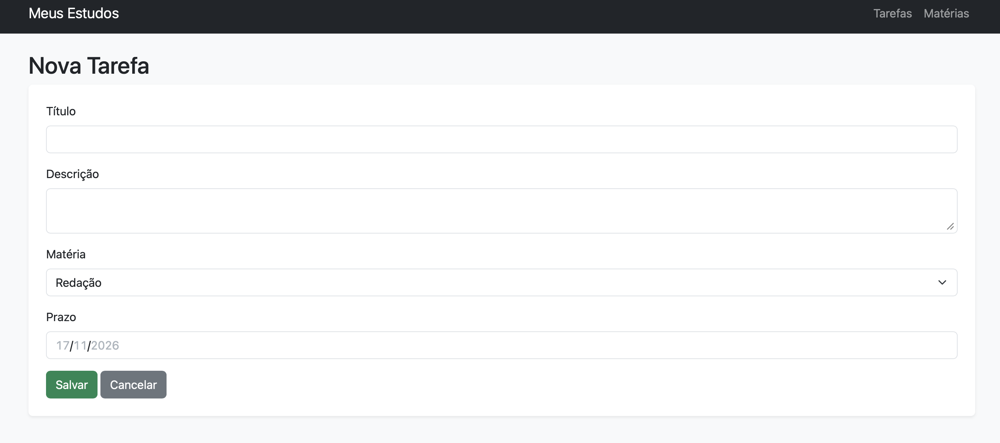
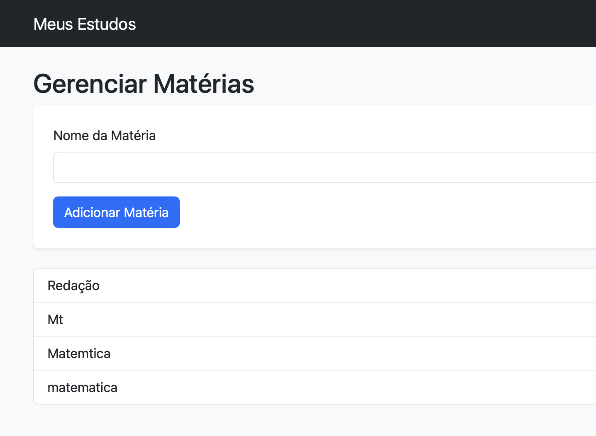
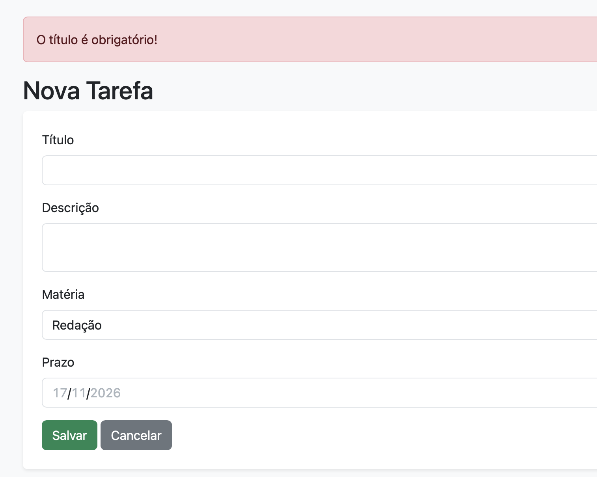
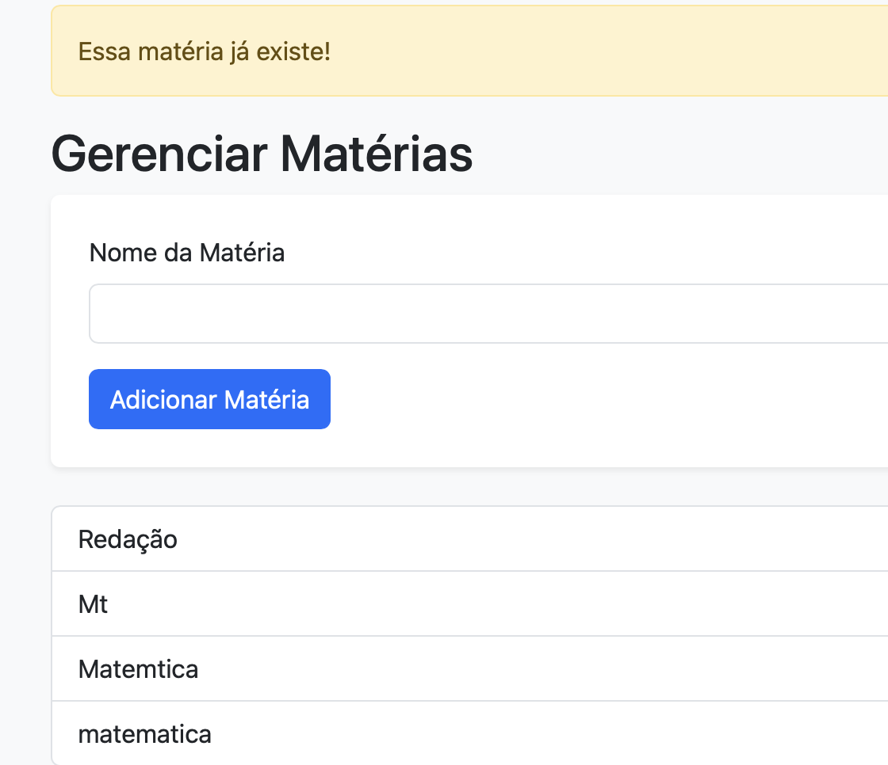
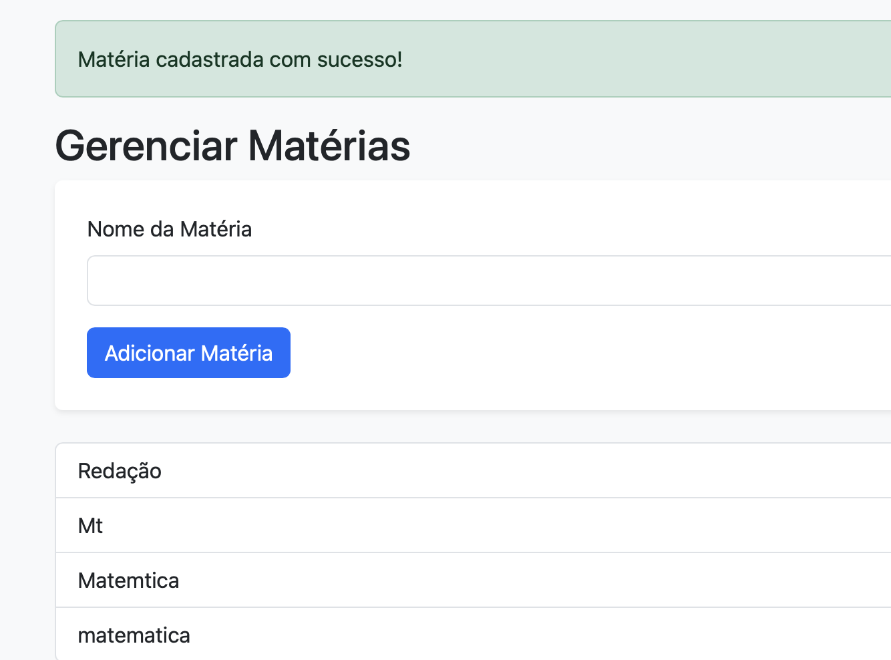

# IHC: telas e mensagens

Este documento descreve a interface do Gerenciador de Tarefas de Estudo: as telas, as mensagens exibidas ao usuário e os princípios de IHC adotados. A interface usa templates Jinja2 com Bootstrap 5, na pasta `app/templates/`.

## 1. Telas

| Tela | Endereço | Template | Objetivo |
|---|---|---|---|
| Lista de tarefas | `/` | `index.html` | Ver as tarefas, filtrá-las, alternar o status e excluir |
| Nova tarefa | `/tarefas/nova` | `form_tarefa.html` | Preencher título, descrição, matéria e prazo |
| Matérias | `/materias` | `materias.html` | Cadastrar matérias e ver as já cadastradas |

Todas as telas herdam o `base.html`, que traz o menu de navegação (Tarefas e Matérias) e a área onde as mensagens aparecem.

### Elementos de interface usados
- **Controles de entrada:** campos de texto, área de texto, lista suspensa de matérias, campo de data e botões.
- **Navegação:** barra de menu no topo e botões de filtro (Todas, Pendentes, Concluídas).
- **Informativos:** mensagens coloridas (alertas) e selos de status (Pendente e Concluída).

## 2. Mensagens do sistema

As mensagens aparecem no topo da página, com cor conforme o tipo: verde para sucesso, vermelho para erro e amarelo para aviso.

| Situação | Mensagem | Tipo |
|---|---|---|
| Título vazio ou só com espaços | O título é obrigatório! | Erro |
| Título com mais de 120 caracteres | O título deve ter no máximo 120 caracteres. | Erro |
| Prazo em formato inválido | O prazo está em um formato inválido. | Erro |
| Matéria inexistente ou não escolhida | Escolha uma matéria válida. | Erro |
| Nome de matéria vazio | O nome da matéria é obrigatório! | Erro |
| Nome de matéria com mais de 80 caracteres | O nome da matéria deve ter no máximo 80 caracteres. | Erro |
| Matéria já cadastrada | Essa matéria já existe! | Aviso |
| Tarefa criada | Tarefa criada com sucesso! | Sucesso |
| Status alterado | Status da tarefa alterado! | Sucesso |
| Tarefa excluída | Tarefa excluída com sucesso! | Sucesso |
| Matéria cadastrada | Matéria cadastrada com sucesso! | Sucesso |

Além das mensagens do sistema, os campos obrigatórios (título e matéria) têm validação no próprio navegador, que impede o envio de formulários em branco. A validação do servidor continua valendo para entradas que o navegador não bloqueia, como um título só com espaços.

## 3. Princípios de IHC aplicados

- **Clareza e simplicidade:** o sistema tem apenas três telas, com rótulos diretos.
- **Consistência:** o menu, os botões e as cores seguem o mesmo padrão em todas as telas.
- **Resposta ao usuário:** toda ação (criar, alternar, excluir, cadastrar) mostra uma mensagem de resultado.
- **Prevenção de erros:** campos obrigatórios e validação dos dados antes de gravar.
- **Controle do usuário:** a exclusão de uma tarefa pede confirmação, e o status pode ser alternado de volta.

## 4. Limitações conhecidas
- Não é possível editar uma tarefa depois de criada nem excluir uma matéria.
- Ao abrir "Nova tarefa" sem nenhuma matéria cadastrada, a lista de matérias fica vazia e o sistema não orienta o usuário a cadastrar uma primeiro.

## 5. Capturas de tela

*Figura 1: Tela inicial com a lista de tarefas, o menu de navegação e os filtros por situação.*

*Figura 2: Lista filtrada, exibindo apenas as tarefas pendentes.*

*Figura 3: Formulário de cadastro de tarefa, com título, descrição, matéria e prazo.*

*Figura 4: Tela de matérias, com o formulário de cadastro e a lista das matérias existentes.*

*Figura 5: Mensagem de erro exibida quando o título é enviado vazio ou só com espaços.*

*Figura 6: Aviso exibido ao tentar cadastrar uma matéria que já existe.*

*Figura 7: Mensagem de sucesso exibida após o cadastro de uma tarefa.*